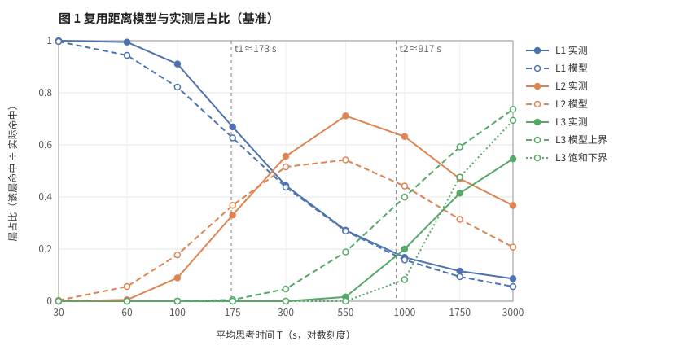
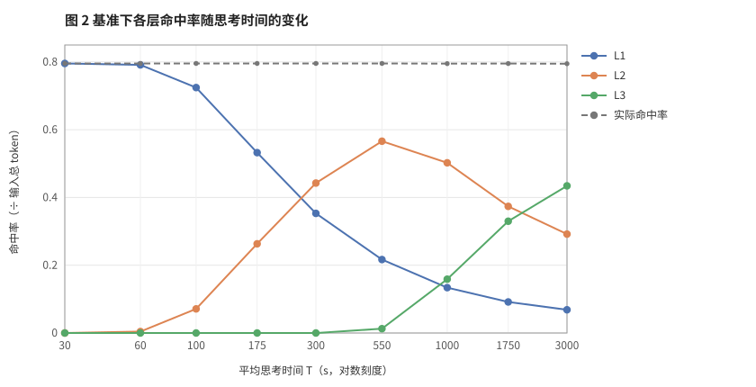
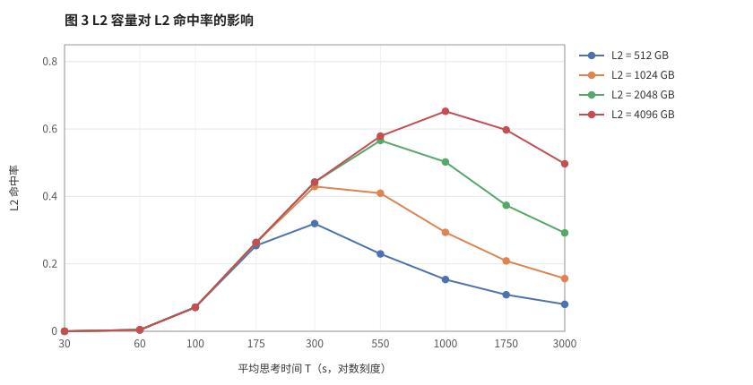
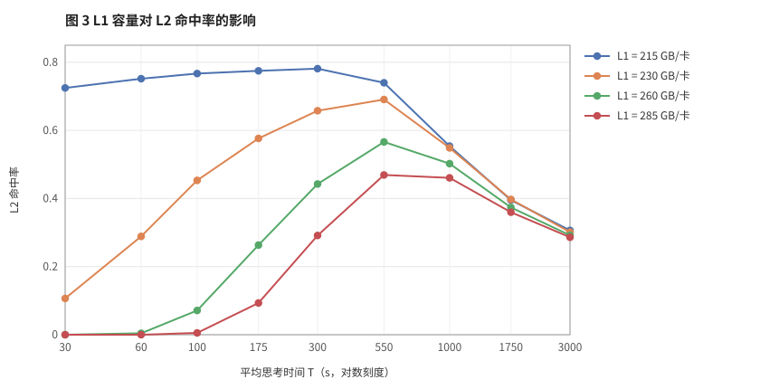
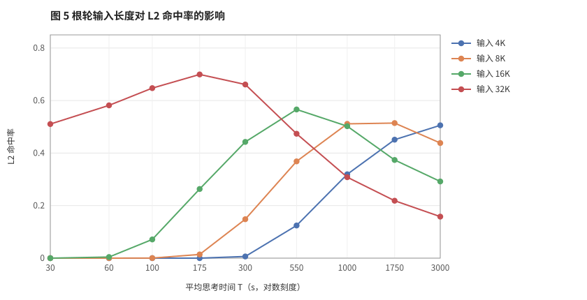
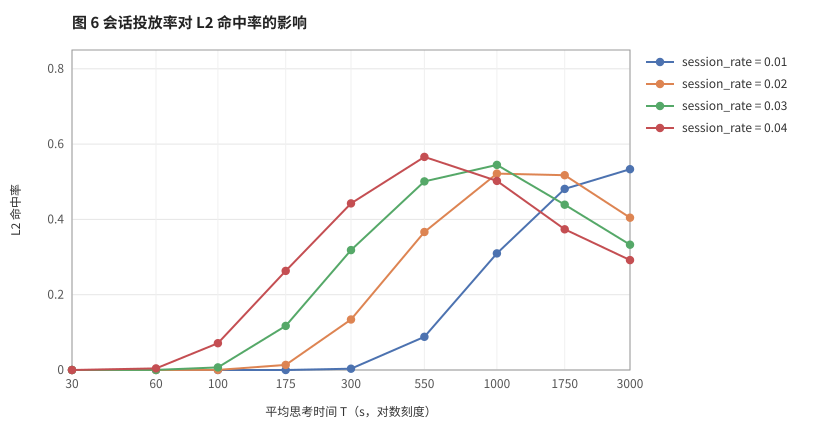
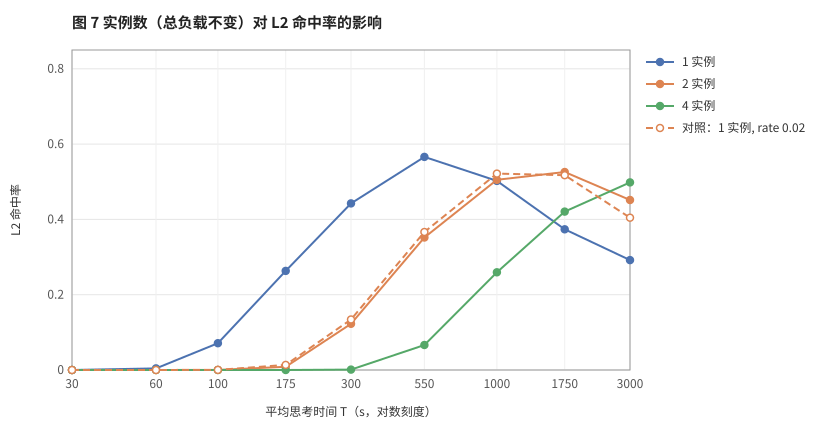
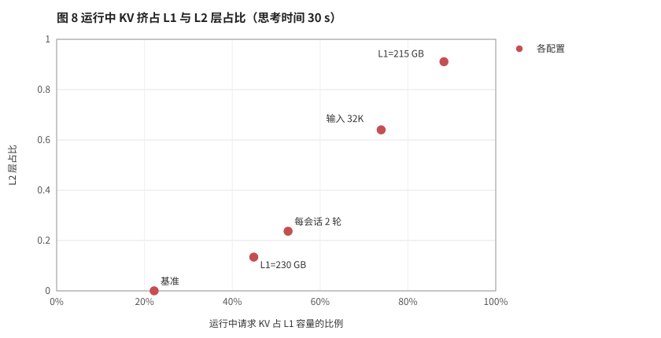
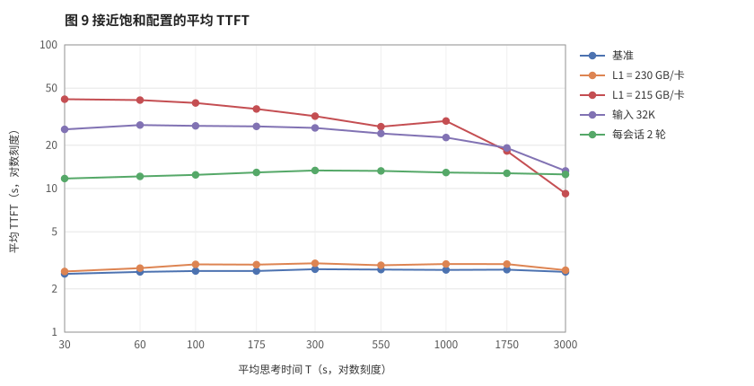
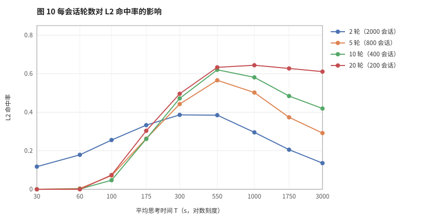

# L2 命中率影响因素分析

用本仿真系统研究哪些因素决定 L2 前缀命中率。本文先推导复用距离模型，再用扫描数据佐证，最后汇总各因素的作用。

- 代码版本：`112ee3d`。
- 计时模式：解析计时，单一种子 `seed=0`。

## 1. 推导：复用距离模型

### 1.1 模型

LRU 下，一个会话的前缀页能否留在某一层，取决于它的复用距离 $D$：从父轮完成发布页面，到子轮准入，期间同一实例上其他请求访问或写入的页数。

设单实例稳态请求率为 $\lambda$（闭环下等于 `session_rate` × 每会话轮数），平均上下文为 $\bar C$，复用间隔为 $t$。排队可以忽略时，$t$ 约等于思考时间，于是

$$
D(t)\approx\lambda\,t\,\bar C
$$

据此可以定义两个临界间隔：

$$
t_1=\frac{\text{L1}}{\lambda\bar C},\qquad t_2=\frac{\text{L1}+\text{L2}}{\lambda\bar C}
$$

- $t<t_1$：命中 L1。
- $t_1<t<t_2$：命中 L2。
- $t>t_2$：只能从 L3 取回。

思考时间服从均值为 $T$ 的指数分布，因此

$$
P_{L1}=1-e^{-t_1/T},\qquad P_{L3}=e^{-t_2/T},\qquad P_{L2}=1-P_{L1}-P_{L3}
$$

### 1.2 由模型得到的推论

1. L2 命中率是 $t_1$ 到 $t_2$ 这个窗口与思考时间分布的重叠部分，所以随 $T$ 呈单峰。
2. $\lambda$、$T$、$\bar C$ 只以乘积形式出现，彼此可以互换。容量放大 k 倍，等价于其中任一项缩小 k 倍。
3. L2 容量只影响 $t_2$，即右边界；L1 容量同时移动两个边界，但主要影响左边界。

## 2. 数据佐证

除特别说明外，下表和图中都是 `l2_prefix_hit_rate`，横向为思考时间，单位 s；图中思考时间轴为对数刻度。

### 2.1 基准配置

| 项目 | 取值 |
|---|---|
| 负载 | 合成闭环，线性会话；4000 个请求，800 个会话（每会话 5 轮）；`session_rate=0.04` 会话/秒，`think_time_ms=300000` |
| 长度 | 根轮输入 Poisson(16384)，每轮新增 Poisson(256)，输出 Poisson(128) |
| 模型与硬件 | HY4-Preview（MLA+DSA，bf16 权重与 KV），单实例 8×B300，TP=EP=8 |
| 调度 | `max_running_requests=32`，`max_prefill_tokens=16384`，P/D 分步执行，`l3_prefetch_min_tokens=256` |
| 存储 | 每卡 L1 260 GB，L2 2048 GB，共享 L3 40 TB；L2→L1 256 GB/s，L3→L2 50 GB/s |

### 2.2 模型与基准数据对照（层占比）

基准取 $\lambda=0.2$ 请求/秒、$\bar C=17161$ token，得到 $t_1\approx173$ s、$t_2\approx917$ s。

| 思考时间 $T$（s） | 30 | 60 | 100 | 175 | 300 | 550 | 1000 | 1750 | 3000 |
|---|---|---|---|---|---|---|---|---|---|
| L1 占比：预测 | .997 | .944 | .822 | .627 | .437 | .269 | .158 | .094 | .056 |
| L1 占比：实测 | 1.000 | .995 | .911 | .669 | .444 | .272 | .168 | .115 | .086 |
| L2 占比：预测下限 | .003 | .056 | .178 | .368 | .516 | .542 | .442 | .314 | .208 |
| L2 占比：预测上限 | .003 | .056 | .178 | .373 | .563 | .731 | .759 | .430 | .250 |
| L2 占比：实测 | 0 | .005 | .089 | .331 | .556 | **.712** | .632 | .470 | .367 |
| L3 占比：模型上界 | .000 | .000 | .000 | .005 | .047 | .189 | .400 | .592 | .737 |
| L3 占比：饱和下界 | 0 | 0 | 0 | 0 | 0 | 0 | .083 | .476 | .694 |
| L3 占比：实测 | 0 | 0 | 0 | 0 | 0 | .016 | .200 | .415 | .546 |

L2 占比的预测为 $1-P_{L1}-P_{L3}$：预测下限取 L3 模型上界，预测上限取 L3 饱和下界。

- **L1 边界**：在 $T\ge175$ s 时预测误差在 0.05 以内。思考时间较短时，实测 L1 占比更高，原因与下一点相同：模型高估了 $D$。
- **L3 边界**：模型把同一会话在复用间隔内的多次访问重复计算了，所以给出的是上界。按“活跃会话总上下文”$M=\lambda T\bar C$ 计算会得到另一个界：$P_{L3}\ge 1-(\text{L1}+\text{L2})/M$，即表中的饱和下界。实测值在 $T\le1000$ s 时落在两界之间。
- **L2 区间**：在 $300\le T\le1000$ s 时，实测值落在预测区间内，峰值同样出现在 550 s。两端的偏离分别来自 L1 和 L3：$T\le175$ s 时，实测 L1 占比高于预测，L2 相应偏低；$T\ge1750$ s 时，实测 L3 占比低于饱和下界，L2 相应偏高。
- $T\ge1750$ s 时，L3 实测值低于饱和下界。原因是会话持续时间（约 $4T$）已经和 20000 s 的投放时长相当，稳态阶段不完整，平均活跃量偏低。这一点见第 4 节。

### 2.3 思考时间（基准，三层命中率）

| 层 | 30 | 60 | 100 | 175 | 300 | 550 | 1000 | 1750 | 3000 |
|---|---|---|---|---|---|---|---|---|---|
| L1 | .796 | .791 | .724 | .532 | .353 | .217 | .134 | .092 | .069 |
| **L2** | .000 | .004 | .071 | .263 | .442 | **.566** | .502 | .374 | .292 |
| L3 | 0 | 0 | 0 | 0 | 0 | .013 | .159 | .330 | .434 |

所有点的实际命中率都在 0.795–0.796，等于理想值。L3 从未淘汰过，峰值驻留约 17.6 万页，不到容量的 23%。各层命中率之和保持不变，思考时间只改变命中在三层之间的分配。

### 2.4 L2 容量：只移动右边界

| L2 容量 | 30 | 60 | 100 | 175 | 300 | 550 | 1000 | 1750 | 3000 |
|---|---|---|---|---|---|---|---|---|---|
| 512 GB | .000 | .004 | .071 | .254 | .320 | .229 | .153 | .108 | .080 |
| 1024 GB | .000 | .004 | .071 | .263 | .429 | .410 | .294 | .209 | .157 |
| 2048 GB | .000 | .004 | .071 | .263 | .442 | .566 | .502 | .374 | .292 |
| 4096 GB | .000 | .004 | .071 | .263 | .442 | .579 | .653 | .597 | .497 |

- 思考时间 ≤175 s 时，四档基本相同，L1 命中也完全一致（.796 → .532）。扩大 L2 不影响左侧。
- L3 命中首次超过 0.005 的思考时间，依次为 175 / 300 / 550 / 1000 s，L2 容量每翻一倍，这个时间大约也翻一倍，与 $t_2\propto\text{L1}+\text{L2}$ 一致。
- **结论**：只有工作集已经超过 L1+L2 时，扩大 L2 才有收益。

### 2.5 L1 容量：移动左边界，并改变运行时负载

| L1 可用容量（KV 页数） | 30 | 60 | 100 | 175 | 300 | 550 | 1000 | 1750 | 3000 | 平均 TTFT |
|---|---|---|---|---|---|---|---|---|---|---|
| 215 GB（2234 页） | .725 | .752 | .767 | .775 | .781 | .740 | .554 | .395 | .306 | 9–42 s |
| 230 GB（4574 页） | .106 | .289 | .453 | .576 | .658 | .691 | .549 | .397 | .301 | 2.6–3.0 s |
| 260 GB（9254 页） | .000 | .004 | .071 | .263 | .442 | .566 | .502 | .374 | .292 | 2.5–2.7 s |
| 285 GB（13154 页） | .000 | .000 | .005 | .093 | .291 | .469 | .461 | .360 | .286 | 2.5–2.7 s |

- L1 越小，L2 命中开始得越早、峰值越高。
- 思考时间 ≥1000 s 时四档趋于一致，因为此时主要由 L1+L2 总量决定，L1 只占小头。
- L1=215 GB 时，KV 容量只有约 14.3 万 token，能同时运行的请求很少。平均 TTFT 升到 9–42 s，P99 升到 58–138 s。用 L1 容量换来的 L2 命中，代价是延迟。

### 2.6 输入长度：整条曲线平移

| 根轮输入均值 | 30 | 60 | 100 | 175 | 300 | 550 | 1000 | 1750 | 3000 | 平均 TTFT |
|---|---|---|---|---|---|---|---|---|---|---|
| 4K | 0 | 0 | 0 | 0 | .006 | .124 | .319 | .451 | .506 | 0.7 s |
| 8K | 0 | 0 | 0 | .014 | .148 | .368 | .511 | .514 | .438 | 1.2 s |
| 16K | .000 | .004 | .071 | .263 | .442 | .566 | .502 | .374 | .292 | 2.6 s |
| 32K | .510 | .582 | .647 | .699 | .661 | .474 | .308 | .218 | .158 | 13–28 s |

- 输入长度每翻一倍，曲线大约左移一档（思考时间约减半），与 $t_{1,2}\propto 1/\bar C$ 一致。
- 32K 档 L2 命中开始得比按比例推算更早，原因见 2.9 节。

### 2.7 会话投放率：单实例请求率的作用

| `session_rate` | 30 | 60 | 100 | 175 | 300 | 550 | 1000 | 1750 | 3000 |
|---|---|---|---|---|---|---|---|---|---|
| 0.01 | 0 | 0 | 0 | 0 | .003 | .088 | .310 | .481 | .533 |
| 0.02 | 0 | 0 | 0 | .014 | .134 | .367 | .522 | .518 | .405 |
| 0.03 | 0 | 0 | .007 | .117 | .318 | .501 | .545 | .439 | .333 |
| 0.04 | .000 | .004 | .071 | .263 | .442 | .566 | .502 | .374 | .292 |

- 投放率越低，曲线越往右移。0.01 档在 3000 s 时仍在上升，L3 只有 0.058。
- 降低投放率还会延长会话投放时长：0.01 档为 80000 s。这样长思考时间档的稳态更充分，与 2.8 节的实例数扫描相比，各档长思考时间下的 L3 命中略高。

### 2.8 实例数（总负载不变）：等价于单实例请求率按比例下降

| 配置 | 30 | 60 | 100 | 175 | 300 | 550 | 1000 | 1750 | 3000 | 平均 TTFT |
|---|---|---|---|---|---|---|---|---|---|---|
| 1 个实例 | .000 | .004 | .071 | .263 | .442 | .566 | .502 | .374 | .292 | 2.5–2.7 s |
| 2 个实例 | 0 | 0 | 0 | .009 | .123 | .352 | .505 | .526 | .452 | 1.9–2.0 s |
| 4 个实例 | 0 | 0 | 0 | 0 | .001 | .067 | .260 | .421 | .498 | 1.7–1.8 s |
| *对照：1 个实例，`session_rate=0.02`* | 0 | 0 | 0 | .014 | .134 | .367 | .522 | .518 | .405 | 2.0–2.2 s |

- 根请求轮询分配，子轮固定回到父轮所在实例，每个实例独占自己的 L1/L2。N 个实例下，单实例请求率变为 $\lambda/N$，复用距离按比例缩小，相当于每实例容量放大 N 倍。
- “2 个实例、投放率 0.04”和“1 个实例、投放率 0.02”的单实例请求率相同，两条曲线在 ≤1000 s 时差距不超过 0.02，L1 曲线也基本重合（.787 对 .782、.673 对 .661、.444 对 .429、.286 对 .268）。这直接支持了推论 1.2-2。
- 两者在 3000 s 时有差别（.452 对 .405）。原因是每实例分到的会话投放时长不同（20000 s 对 40000 s），稳态完整程度不一样。
- 实例数增加时 TTFT 也下降，因为每实例负载降低了。

### 2.9 运行中请求的 KV 挤占 L1

运行中请求的 KV 是私有页或带引用的页，不能当缓存用，所以会压缩 L1 的有效缓存容量。下面在思考时间 30 s 下，用本地仿真按请求记录统计时间平均值：

| 配置 | 平均运行请求数 | 平均运行中 KV | 占 L1 比例 | 平均排队请求数 | TPOT | L2 层占比 |
|---|---|---|---|---|---|---|
| 基准 | 7.7 | 13.2 万 | 22% | 0.2 | 299 ms | 0.000 |
| L1=230 GB | 7.7 | 13.2 万 | 45% | 0.2 | 299 ms | 0.134 |
| 每会话 2 轮 | 18.8 | 31.2 万 | 53% | 1.7 | 721 ms | 0.237 |
| 输入 32K | 13.0 | 43.8 万 | 74% | 4.4 | 508 ms | 0.640 |
| L1=215 GB | 7.3 | 12.6 万 | 88% | 7.8 | 286 ms | 0.911 |

- 运行中 KV 占 L1 的比例越高，思考时间 30 s 下的 L2 层占比就越高，两者随配置单调变化。
- 解析计时下 TPOT 约 0.3 s，单请求驻留时间约 40 s（TTFT 加上 127 个 TPOT）。即使在基准下，运行中请求平均也占用了 22% 的 L1。
- 这解释了为什么在 L1=215、输入 32K、每会话 2 轮这三组中，按 1.1 节模型推算 30 s 下应在 L1 命中，实际却大量落到 L2：负载接近饱和时，L1 的有效缓存容量明显小于标称容量，同时还伴随 TTFT 上升。

图 9 汇总了这几组接近饱和配置的延迟代价：基准与 L1=230 GB 的平均 TTFT 约 2.5–3 s，而 L1=215 GB、输入 32K、每会话 2 轮分别为 9–42 s、13–28 s、12–13 s。

### 2.10 每会话轮数

| 每会话轮数（会话数） | 理想命中率 | 30 | 100 | 175 | 300 | 550 | 1000 | 3000 | 平均 TTFT |
|---|---|---|---|---|---|---|---|---|---|
| 2（2000） | .497 | .118 | .256 | .333 | .386 | .385 | .296 | .136 | 11.7–13.4 s |
| 5（800） | .796 | .000 | .071 | .263 | .442 | .566 | .502 | .292 | 2.5–2.7 s |
| 10（400） | .895 | .000 | .047 | .261 | .472 | .621 | .581 | .420 | 1.4–1.6 s |
| 20（200） | .945 | .000 | .074 | .304 | .496 | .633 | .644 | .611 | 0.9–1.0 s |

- **理想命中率随轮数上升**，约为 $1-1/n$（$n$ 为每会话轮数）。根轮占比越低，预填充计算越少，TTFT 也越低。
- **轮数 ≥5 时，L2 命中开始出现的位置基本一致**（100–175 s）。因为 $\lambda$ 相同，$\bar C$ 只略有增加：20 轮时上下文增长到约 2 万 token。
- **长思考时间下，轮数越多，L2 命中保持得越高**。3000 s 时，20 轮的 L3 层占比只有 0.14，而 5 轮是 0.55。原因有两个，目前没有单独区分：
  - 会话总数少，限制了总工作集：200 个会话 × 约 2 万 token ≈ 400 万，接近 L1+L2。
  - 会话持续时间远超投放时长，3000 s 档的平均到达 QPS 只有 0.037。
- **2 轮档根轮占一半**。预填充负载重，接近饱和，平均运行请求数为 18.8。即使思考时间只有 30 s，也有 L2 命中，这是 2.9 节机制的又一例证。

## 3. 因素汇总

| 因素 | 作用于 | 影响方向 | 敏感度 | 证据 |
|---|---|---|---|---|
| 思考时间 $T$ | 复用间隔 $t$ | L2 先升后降，单峰 | 很高 | 2.2，2.3 |
| 平均上下文 $\bar C$ | 复用距离 $D$ | 增大时曲线左移；过大时导致排队 | 高 | 2.6 |
| 单实例请求率（投放率、实例数） | 复用距离 $D$ | 增大时曲线左移 | 高 | 2.7，2.8 |
| L1 有效容量 | 左边界 $t_1$ | 越小，L2 命中越早出现、峰值越高，但延迟变差 | 高 | 2.5 |
| L2 容量 | 右边界 $t_2$ | 越大，峰值越往右、越高；短思考时间下无效 | 中，有条件 | 2.4 |
| 运行中 KV 挤占（负载、上下文、并发） | L1 有效容量 | 挤占越多，L2 命中越提前 | 接近饱和时高 | 2.9 |
| 每会话轮数 | 理想上限、根轮负载、总工作集 | 轮数越多上限越高，长思考时间下 L2 保持得越好 | 中 | 2.10 |

## 4. 局限

- **单一种子**，没有估计随机波动。
- **长思考时间档的稳态不完整**。$T\ge1750$ s 时，会话持续时间与投放时长相当，绝对数值偏保守。
- **吞吐不能当性能指标**。闭环下吞吐（0.194 → 0.068）随思考时间变化，是会话变长、尾部拉长造成的，不代表系统能力变化。
- **结论依赖 L3 很大**。L3 为 40 TB 且从未淘汰，超出 L1+L2 的部分全部由 L3 取回，所以总命中率不变。L3 容量受限或关闭时，长思考时间档会出现重新计算。
- **未覆盖的因素**：`kv_dtype`、`weight_dtype` 改用 fp8，长尾长度分布，L3 容量受限，L3→L2 带宽。
- **仿真本身的限制**：淘汰策略固定为 LRU，L1/L2 之间只迁移不备份，不支持跨会话公共前缀，思考时间固定为指数分布。
